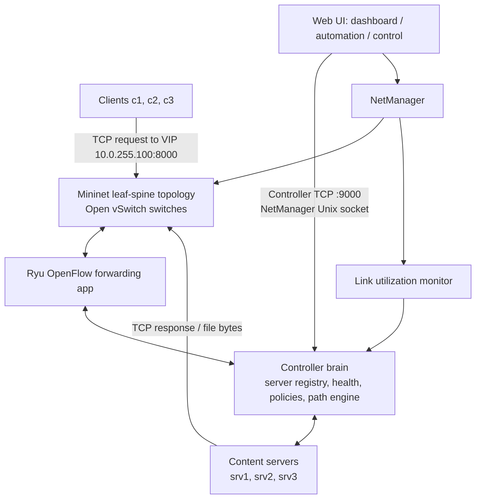

# Project Architecture and Design

## 1. Overview

The Smart Content Delivery System provides one virtual service address for clients while multiple TCP content servers run behind it. A Ryu/OpenFlow controller selects a healthy content server for each new connection. NetManager creates and manages the Mininet leaf-spine topology, while the controller maintains server state, chooses paths, and reacts to network changes.

## 2. Main components

| Component | Responsibility | Main implementation |
|---|---|---|
| Client and content server | Request files over TCP; support offset-based resume; report transfer time and throughput. | `app/client.py`, `app/server.py` |
| NetManager / Mininet | Create hosts, switches and links; start services; simulate congestion and failures; expose a local Unix-socket command interface. | `netmanager.py` |
| OpenFlow forwarding | Handle ARP for the virtual IP, rewrite VIP traffic to the selected server, and install forwarding rules. | `forwarding_app.py` |
| Controller brain | Track server registration, heartbeats and load; select a server using the configured policy; calculate routes. | `controller/` |
| Link monitor | Read switch-link interface counters and report measured utilization to the controller. | `monitor_poller.py`, `controller/monitor.py` |
| Web interfaces | Show live state and provide controls/automation for demonstrations. | `ui/dashboard.py`, `ui/automation.py`, `ui/control.py` |
| Evaluation | Run tests and compare policies under normal, congestion and failure conditions. | `tests/`, `experiments/`, `app/compare_results.py` |

## 3. Design / request flow

1. A client connects to the virtual IP `10.0.255.100` on TCP port `8000`.
2. The OpenFlow forwarding application intercepts the first packet for a new connection.
3. The forwarding application asks the controller brain to select an ACTIVE content server.
4. The forwarding application installs edge-switch rules that rewrite the virtual destination to the selected server and rewrite the response back to the virtual service address.
5. The controller's path engine computes routes through the leaf-spine topology. Switches forward subsequent packets using installed flow rules.
6. The content server returns a response header and file bytes. The client can reconnect using the received byte offset if a server failure interrupts a download.
7. NetManager's monitor samples link counters. The controller smooths utilization measurements and can prefer less-congested paths/servers when the `smart` policy is active.

## 4. Architecture diagram

## 5. Server-selection policies

- `static`: selects the first ACTIVE server; used as the baseline.
- `round_robin`: rotates across ACTIVE servers.
- `least_conn`: selects the ACTIVE server with the fewest active connections.
- `smart`: scores eligible servers using normalized server load, bottleneck path utilization and path delay. See `docs/D2.md` for the formula and evaluation details.

## 6. Failure and congestion handling

- **Link failure:** the controller recomputes routes and updates affected forwarding entries.
- **Server failure:** missed heartbeats cause the server to be marked DOWN; the client reconnects through the virtual IP and resumes from its last byte offset.
- **Congestion:** the monitor reports link utilization; the `smart` policy can avoid congested paths. The established TCP transfer is not migrated to another server simply because a new server scores better.

## 7. Supporting design documents

- `CONTRACT.md`: interfaces between the integrated components.
- `INTEGRATION.md`: integration decisions and component merge details.
- `docs/D2.md`: D2 monitoring, policies, evaluation method, limitations and demo procedure.
- `docs/network_forwarding_member_b.md`: network and forwarding implementation details.
